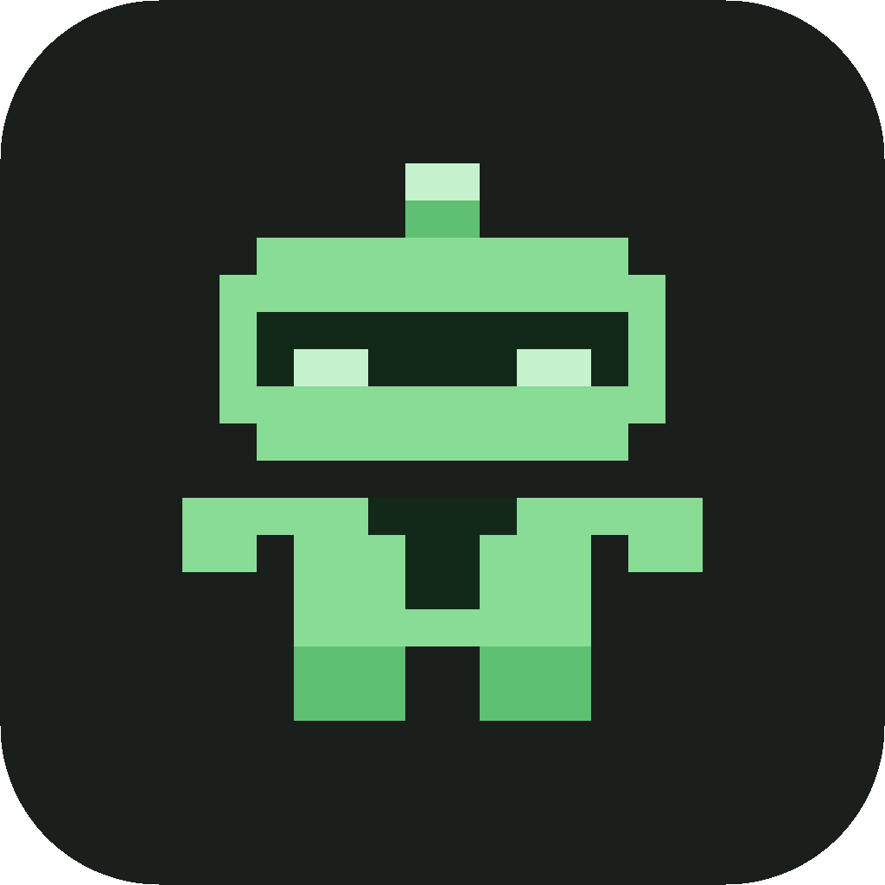

<p align="center"></p>

<h1 align="center">agentik</h1>

<p align="center">Guardrails for long, unattended Claude Code work.</p>

agentik is five Claude Code plugins, with their command line tools, for agent work that runs for hours with nobody watching.
They give each session a budget and a hard stop, and they merge overnight work only when its checks pass.
You read one report in the morning, and every stopped session leaves a way back in.

## A short tour

You write each task as a packet: a short file that says what to build and how to check it.
relay works through a queue of packets overnight.
Each packet gets its own branch, its own copy of the repo and its own Claude Code session.
A branch merges only when its checks pass, and nothing is pushed.

session watches each of those sessions.
It counts context and turns, warns at 80%, and at 100% tells the session to finish its current step and exit.
Before it exits, the session brings a short charter up to date: what it was for, how it ended, what comes next.
A fresh session starts from that charter, so long work continues without compacting the old context.

decisions keeps what a project has already settled in one file, `DECISIONS.md`.
It copies the few rules every session needs into `CLAUDE.md`.
Agents may draft questions, but only you settle them.

respeak writes your agents' work for you as a narrative in one of three modes: `eli5`, `bluf` or `technical`.
Everything it writes for people passes a check against a list of banned phrases.

agents runs side work, such as a read-only code review, on a local model at no marginal cost.
`agentik agents status` shows what every agent is doing right now.

## The repos

### [agentik-commons](https://github.com/agentik-dev/agentik-commons)

The ground the five tools share; it builds no tool of its own.
It holds the `agentik` marketplace that every plugin installs from, the `agentik` front door, and the guide the tools follow for names, verbs and exit codes.
Add the marketplace once:

```sh
claude plugin marketplace add agentik-dev/agentik-commons
```

Each command line tool below installs from a clone with `make install`, into `~/.local/bin`, before its plugin, `<plugin>@agentik`.
`make install` also installs the front door: `agentik <tool> …` runs `agentik-<tool>`, and `agentik` alone lists the tools it finds.

### [agentik-session](https://github.com/agentik-dev/agentik-session)

A plugin, `session`, and a tool, `agentik-session`, that give each Claude Code session a profile, a budget with a hard stop, and a written charter.
Use it so a session winds down at a known point and leaves a record you can read.

```sh
git clone https://github.com/agentik-dev/agentik-session.git
cd agentik-session && make install  # agentik-session; /usr/bin/python3, 3.9 or newer
claude plugin install session@agentik
```

Then run `agentik session doctor` to check the setup.

### [agentik-relay](https://github.com/agentik-dev/agentik-relay)

A Go binary, `agentik-relay`, and a plugin, `relay`, that run a queue of packets overnight with no one at the keyboard.
Each queue row merges into `main` only when its gate passes, and `agentik relay resume <row>` reopens any row that stopped.

```sh
git clone https://github.com/agentik-dev/agentik-relay.git
cd agentik-relay && make install  # agentik-relay; needs Go
claude plugin install relay@agentik
```

Then run `agentik relay doctor` to check the machine for a night.

### [agentik-decisions](https://github.com/agentik-dev/agentik-decisions)

A plugin, `decisions`, and a tool, `agentik-decisions`, that keep a repository's settled decisions in one short `DECISIONS.md`.
Use it so every session finds the rules it must follow without reading a long file whole.

```sh
git clone https://github.com/agentik-dev/agentik-decisions.git
cd agentik-decisions && make install  # agentik-decisions and the agentik front door
claude plugin install decisions@agentik
```

Then run `agentik decisions doctor` to check the setup.

### [agentik-respeak](https://github.com/agentik-dev/agentik-respeak)

A plugin, `respeak`, where each person reads a narrative of the agents' work written for them.
Use it to read your agents' work in `eli5`, `bluf` or `technical` mode without learning their dialect.

```sh
claude plugin install respeak@agentik
```

It has no command line tool yet; it needs Claude Code 2.1.196 or newer and a python3 with PyYAML.
It needs no setup per project, and it ships no hooks: nothing runs until you call `/respeak:respeak`.

### [agentik-agents](https://github.com/agentik-dev/agentik-agents)

A tool, `agentik-agents`, and a plugin, `agents`, that show what every agent is doing and run a session's mechanical subagents on a local model.
Use it to see every seat, helper and local agent in one view, and to run side work at no marginal cost.

```sh
git clone https://github.com/agentik-dev/agentik-agents.git
cd agentik-agents && make install  # agentik-agents and its tools
claude plugin install agents@agentik
```

The local lane needs Ollama and a local model, and `agentik agents route --check` names whatever is missing.
Then run `agentik agents doctor` to check the setup.

## How they fit

| Plugin | Its job | With the others |
|---|---|---|
| session | A budget, a hard stop and a charter for each session | Writes one resolved configuration that relay, decisions and respeak read |
| relay | An overnight queue, one branch per packet, a gated merge | Starts each packet as a `builder` session; renders its morning report through respeak |
| decisions | One ledger of settled decisions | Renders its open questions through respeak |
| respeak | A narrative of agent work, in the reader's mode | Takes the session's tone from session |
| agents | A status view of every agent, and a local model for side work | Its status view lists the sessions that session tracks |

Each one installs and works alone; a link in the last column turns on when the other plugin is installed.

## Status

agentik is early and built for the author's own daily use, so expect breaking changes between versions.
Issues are welcome on each repo, and each repo is MIT-licensed.

agentik is unofficial and not affiliated with Anthropic.
Claude and Claude Code are Anthropic's products.
