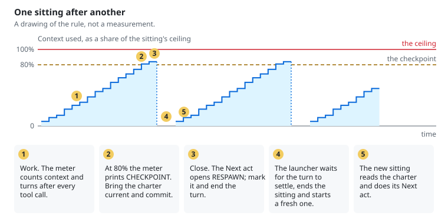

# How agentik manages a context window

This page is the whole idea on one page: the rule, its life cycle and its numbers.
At the end you will know why each agentik session stops well short of its model's window, what it leaves behind, and which of the four longer pages to read next.

A few words first.
A *sitting* is one Claude Code session, from its start to its exit.
The *window* is the most context the model can hold: 200k or 1M tokens.
A *ceiling* is the budget agentik-session sets for a sitting, below the window.
The *charter* is a short file, under 4,096 bytes, that says what the sitting is for, what is done and what comes next.
An *orchestrator* is a long-lived sitting that plans the work and hands parts of it to *helpers* (subagents).

## The rule in five lines

1. Each sitting gets a ceiling on context and on turns: 180k tokens for most roles, 400k for an orchestrator on a 1M window, and 400 turns for every role.
2. After every tool call a meter reads the session's own transcript. At 80% of either ceiling it prints `CHECKPOINT:`.
3. At the checkpoint the sitting brings its charter up to date and commits its work.
4. It closes on RESPAWN: the charter's *Next act*, the one step the next sitting takes first, opens with the word `RESPAWN:`. A launcher, `agentik session run`, then ends the sitting and starts a fresh session with the same arguments. Nothing is compacted.
5. The fresh sitting reads the charter and carries on from its Next act.

*The life cycle of a sitting, as a drawing: the steps of the rule above, numbered the same way.*

## The numbers

| what | value | source |
|---|---|---|
| ceiling, every role but the orchestrators | 180,000 tokens and 400 turns, on a 200k or a 1M window | [profiles.yaml](https://github.com/agentik-dev/agentik-session/blob/main/plugin/lib/claude_session/profiles.yaml) |
| ceiling, the two orchestrator roles on a 1M window | 400,000 tokens and 400 turns | the same file |
| checkpoint | 80% of either ceiling, the larger share deciding | the same file; [README, Budget](https://github.com/agentik-dev/agentik-session#budget) |
| zones | notice from 80%, wind-down from 90%, reserve from 92%, exhausted at 100% | [README, Budget](https://github.com/agentik-dev/agentik-session#budget) |
| charter | six parts, under 4,096 bytes | [README, The charter](https://github.com/agentik-dev/agentik-session#the-charter) |
| launcher guards | at most 20 restarts of a chain in any 24 hours, no restart before a sitting is 600 s old, a 60 s settle | [profiles.yaml](https://github.com/agentik-dev/agentik-session/blob/main/plugin/lib/claude_session/profiles.yaml) |
| sittings measured | 1,867 from 2026-09-24 to 2026-11-16: 1,107 under the 400k ceiling, 760 under the 180k one | [data/sittings_summary.csv](data/sittings_summary.csv) |
| median peak context | 79.5% of the ceiling (400k), 80.0% (180k) | the same file |
| sittings that reached or passed the ceiling | 54 of 1,107 (4.9%) and 151 of 760 (19.9%) | [data/sittings_hist.csv](data/sittings_hist.csv) |
| launcher restarts | 773 on 35 days, a median of 22 a day | [data/restarts.csv](data/restarts.csv) |

The ceiling is a signal, not a wall.
The meter tells the sitting to stop, and most sittings do; 205 of the 1,867 reached or passed it.
The measured rows come from the makers' own use of the tools, one owner's record (the *owner* is the person the sittings work for); the CSVs hold the numbers and nothing else.
[`tools/context_figures.py`](../../tools/context_figures.py) draws every figure on these pages from them.

## The four pages

- [Why a ceiling below the window](why-a-ceiling.md): why both roles stop below the model's window, why at 80%, and what the record shows about the sittings that did not.
- [Reading the band](the-band.md): the two lines above Claude Code's prompt and the lines the hooks add to the model's context, element by element.
- [The charter and the launcher](respawn.md): how a sitting hands off, and what `agentik session run` checks before it restarts one.
- [Living inside usage windows](usage-windows.md): the five-hour and weekly limits, what the usage band projects, and how work survives a limit.

## Read more

- [agentik-session](https://github.com/agentik-dev/agentik-session): the plugin and its command line tool, with the profiles, the meter, the charter and the launcher.
- [agentik-session, on the research site](https://agentik-dev.github.io/agentik-research/tools/session/): the tool's evidence, what has worked and what is open.
- [Length and compaction](https://agentik-dev.github.io/agentik-research/field/length-and-compaction/): the studies behind a short context and a written handoff.
