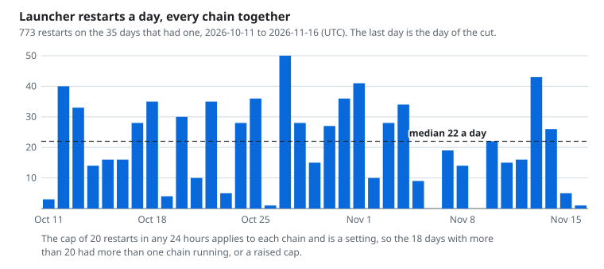

# The charter and the launcher

At its checkpoint a sitting does not compact; it writes down where it is, and a launcher starts a fresh session that reads it.
At the end of this page you will know what a charter holds, what a RESPAWN close is, and what `agentik session run` checks before it restarts a sitting.

## The charter

The charter is one markdown file per sitting, `history/sittings/<date>-<n>.md`, in the repo the sitting works in.
It has six parts and stays under 4,096 bytes:

- a title, and a table: the goal, the budget, the pin (the commit the work starts from), the window, the agents;
- `## Done-ness`: what is finished;
- `## Handover`: what the next sitting needs to know;
- `## While waiting`: what can run while something else is pending, or `- none`;
- `## Next act`: the one step the next sitting takes first.

`agentik session charter open "<goal>"` writes it, `charter check` checks its shape, and `charter close` adds the exit line.

Why a written file and not a summary?
A compaction keeps the gist and loses exact values, and nothing measured shows that it beats a restart, or the reverse ([Length and compaction, question 2](https://agentik-dev.github.io/agentik-research/field/length-and-compaction/#question-2-compaction-or-restart)).
The makers ruled for the restart on two grounds of their own: a restart reads its brief fresh, and a compaction needs a person's hand ([Restart, don't compact](https://agentik-dev.github.io/agentik-research/journal/2026/10/05/restart-dont-compact/)).

## The RESPAWN close

A *RESPAWN close* is how a sitting ends at its checkpoint so that the launcher can start the next one.
When the meter prints `CHECKPOINT:`, the sitting:

1. waits for every helper and background job it started to finish;
2. brings the charter current, with a Next act whose first line opens `RESPAWN` (`RESPAWN:`, `RESPAWN.` or `RESPAWN at 80% context.`, never `Respawn:`);
3. commits;
4. runs `agentik session checkpoint --respawn --charter <file>` from its main thread, and ends its turn.

The verb reads only the charter's `## Next act`. If the first line does not open on `RESPAWN`, it exits 2 and writes nothing.
Otherwise it writes a marker, and the plugin's PostToolUse hook confirms the call came from the main thread, not from a helper.
With `--state <file>` the sitting can also hand its successor one short checked file: its helpers, its gates, its last acts and what to read first.

## The launcher

You start a chain once, in your terminal, with the arguments you would give `claude`:

```sh
CLAUDE_SESSION_PROFILE=orchestrator-opus agentik session run -- --model 'opus[1m]' 'Read the newest charter under history/sittings and act from its Next act.'
```

The launcher starts `claude` with a fresh session id and those same arguments every time; only `--model` follows the model the last sitting ended on.
Then it watches the plugin's stamps, never the transcript.


*What `agentik session run` does at a RESPAWN close, as a drawing of the design and the launcher's code.*

Before it ends a sitting, the launcher checks five things, and any one of them holds the sitting open:

- the marker is this sitting's and the main thread confirmed it;
- the charter's Next act still opens on `RESPAWN`, and the sitting touched the charter;
- no STOP file is newer than the chain: `respawn/STOP` stops every chain, `respawn/<chain>/STOP` stops one;
- the chain has made fewer than 20 restarts in the last 24 hours (the *cap*); an unreadable ledger counts as full;
- the sitting is at least 600 seconds old (the *floor*), so a sitting that fails at once cannot restart in a loop.

During the 10-second grace it prints one line, and Ctrl-C or a STOP file ends the chain there:

```
<chain>: sitting <n> ended on RESPAWN (<charter>); restart <k> of 20 in 24 h in 10 s; touch <state>/respawn/<chain>/STOP or press Ctrl-C to end the chain
```

It never compacts, resumes or forks a session, never runs Claude Code in print mode, and never restarts after a crash.
It never leaves your terminal: no background job, no scheduler.

## Why a launcher

Before the launcher, the restart waited for a person.
On 2026-10-05 one orchestrator reached its checkpoint three times; each time it then sat idle until someone restarted it by hand, for 113, 181 and 83 minutes, 6 hours 17 minutes in all.
Each restart went cleanly, because the next sitting read its charter.
Only the restart itself needed a person, so the launcher does that step ([the respawn design](https://github.com/agentik-dev/agentik-session/blob/main/design/respawn-r1.md)).



*Launcher restarts a day, every chain together, from [the data](data/restarts.csv).*

The launcher made 773 restarts on 35 days, a median of 22 a day and at most 50, on 2026-10-27.
The cap of 20 applies to each chain, so the 18 days with more than 20 restarts had more than one chain running, or a raised cap, since the cap is a setting.
Across the 35 days, the median of each day's median sitting length is 109 minutes.

## Read more

- [The respawn design](https://github.com/agentik-dev/agentik-session/blob/main/design/respawn-r1.md): the launcher's rules, its guards and what it cannot see.
- [agentik-session, The charter and Budget](https://github.com/agentik-dev/agentik-session#the-charter): the charter's verbs and the RESPAWN close.
- [agentik-session, on the research site](https://agentik-dev.github.io/agentik-research/tools/session/#what-has-not-worked-and-what-is-open): what has failed, including a sitting that wrote RESPAWN and never ran the checkpoint.
- Next: [Living inside usage windows](usage-windows.md), or back to [the overview](README.md).
