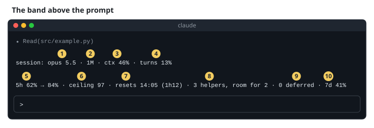
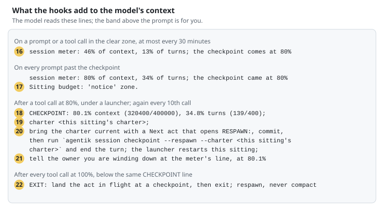

# Reading the band

agentik-session draws two lines above Claude Code's prompt, the *band*, and adds a few short lines to the model's context through its hooks.
At the end of this page you will be able to read each part of both, and know which ones you see and which ones the model reads.

The band is for you: the model does not see it.
The plugin's *hooks module*, the part of it that Claude Code loads into its own screen, draws the band in the area above the prompt. It reads files that the plugin's *classic hooks* write, the commands Claude Code runs at events such as a tool call.
If the module does not load, the band reads `session: no meter · agentik-session doctor`, and `agentik session status` prints the same figures in your terminal.

## The two lines

*Drawn from the plugin's output at 2.0.0-alpha.128, against made-up figures: an orchestrator at 46% of its context.*

The first line is the sitting's own budget.

1. `opus 5.5`: the model, from the session's transcript.
2. `1M`: the window the ceilings apply to. If Claude Code's own reading of the window differs, the band shows both, as `1M (engine 200k)`, until the next tool call catches up.
3. `ctx 46%`: context used, as a share of the context ceiling. Here it is 184,000 of 400,000 tokens.
4. `turns 13%`: turns used, as a share of the turn ceiling, 52 of 400. The larger of the two shares sets the zone.

The second line is the *usage band*: the account's five-hour usage window, and what agentik-session projects for it.

5. `5h 62% → 84%`: the five-hour window is 62% used now, and the band projects 84% at its reset if no new helper starts.
6. `ceiling 97`: the band's own ceiling for the window, which is not the context ceiling. It leaves a margin of 3 below it.
7. `resets 14:05 (1h12)`: when the five-hour window resets, in local time, and the time left. When the weekly reset comes first, this part reads `week resets` with its time.
8. `3 helpers, room for 2`: the helpers running now, and how many more of the same model family fit under the ceiling less the margin.
9. `0 deferred`: spawns in this window that the band would have held back. Today it only advises, so none was held.
10. `7d 41%`: the seven-day window's reading.

A part with no figure is left out, and a line older than two minutes ends with its age, such as `· 140s old`.
[How the band projects the window](usage-windows.md#what-the-usage-band-projects) is on the usage page.

## Other states

*Drawn from the plugin's output at 2.0.0-alpha.128, against made-up figures.*

11. `notice`: the zone's word. The band names the zone once it leaves `clear`: `notice` from 80%, `wind-down` from 90%, `reserve` from 92%.
12. `respawn marked`: the sitting has closed on RESPAWN, which means its charter's *Next act*, the one step the next sitting takes first, opens with `RESPAWN:`, and it has marked that close; the launcher restarts it once the turn settles. See [the launcher](respawn.md).
13. `exhausted`: the sitting is at its ceiling. The model now reads `EXIT:` after every tool call.
14. `no 5h window`: this login has no five-hour window, so the line shows the week instead.
15. `week resets Fri 13:00`: when the weekly window resets.

When the model's own usage limit ends a turn, the first line says so in place of the zone: `limit: the model's limit ended the last turn; /model to switch`.

## What the model reads

The model never sees the band. It reads these lines, which the plugin's hooks add to its context.

*Drawn from the plugin's output at 2.0.0-alpha.128, against made-up figures; long lines are wrapped for width, never changed.*

16. **The meter line.** In the clear zone it comes at most every 30 minutes, on a prompt or a tool call, in whole percentages rounded down. It names the checkpoint, so the sitting knows where it is going. The band rounds to the nearest whole instead, so the same 139 of 400 turns, which the meter keeps as 34.8%, reads `turns 35%` in the band and `34% of turns` here.
17. **The zone line.** Past the checkpoint, every prompt carries the meter line and the zone's name. In the reserve and at the ceiling it also tells the sitting to finish or park what is in flight, commit and write the handoff. The usage band's line follows on each prompt.
18. **`CHECKPOINT:` and its figures.** Both shares, with the counts behind them. It comes at the first crossing of 80%, then on every tenth tool call.
19. **The charter.** Under a launcher, the line names the charter this sitting opened, or `<this sitting's charter>` when it opened none. Without a launcher it says to bring the charter current, commit, then exit.
20. **The close.** Bring the charter current with a Next act that opens `RESPAWN:`, commit, run the checkpoint command, and end the turn.
21. **Tell the owner.** The *owner* is you, the person the sitting works for. The sitting says it is winding down at the meter's line, so you can tell a planned close from an early stop.
22. **`EXIT:`** At 100%, after every tool call, below the same `CHECKPOINT:` line: land the act in flight, then exit; respawn, never compact.

None of these lines blocks anything. They are signals, and the sitting acts on them.

## Read more

- [agentik-session, Budget](https://github.com/agentik-dev/agentik-session#budget): the meter, the zones and the lines, as the tool documents them.
- [The mod design record](https://github.com/agentik-dev/agentik-session/blob/main/design/mod-r1.md): why the band only draws and never decides.
- [Living inside a usage window](https://agentik-dev.github.io/agentik-site/journal/2026/10/14/living-inside-a-usage-window/): the journal entry on the usage band.
- Next: [The charter and the launcher](respawn.md), or back to [the overview](README.md).
