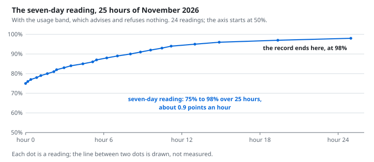

# Living inside usage windows

A Claude Code subscription meters use in rolling five-hour windows under a weekly limit, and long unattended work meets both.
At the end of this page you will know what agentik's usage band projects and advises, what a waiting sitting does at a reset, and how a sitting's work survives a limit.

## The two limits

As of October 2026, a Pro or Max subscription has a five-hour session limit and a weekly limit, both shared with chat; Max adds a weekly Fable limit.
Anthropic publishes no token counts for either.
A helper's requests count toward the same limits as its sitting's.
At a limit, Claude Code's `autoContinueAtUsageLimit` (on by default) resumes an open interactive session, re-arming at most twice; it is not offered in print mode.
A background helper that hits the limit is marked failed, and its work has to be sent again.
See [Budgets and pacing](https://agentik-dev.github.io/agentik-research/field/budgets-and-lanes/#question-4-budgets-and-pacing) and [the admission design](https://github.com/agentik-dev/agentik-session/blob/main/design/admission-r1.md#1-the-problem).

## What the usage band projects

The *usage band* is the second line of [the band](the-band.md).
Claude Code hands the plugin each new five-hour and seven-day reading, and the plugin keeps them in one ledger per machine, with every helper it sees start and finish.

*How the band projects a five-hour window: a drawing of the design, not a measurement.*

- **The burn.** From the ledger, the band fits how many points a minute each running main thread and each model family of helper burns. Until the ledger holds 20 ten-minute intervals, seed values stand in.
- **The peak.** It projects the window's peak at its reset: the reading now, plus the main threads' burn to the reset, plus what each running helper has left.
- **The room.** `room for N` is how many more helpers of the sitting's model family fit under the band's ceiling, 97, less a margin of 3. It tells the orchestrator to pull work forward while there is room.
- **The week.** When the weekly reset comes before the five-hour one, the background burn is projected to the weekly reset instead, because weekly allowance left at its reset is lost.

The makers' aim for the band is to use at least 90% of each five-hour window without crossing 100%.
`agentik session report` marks each window `held` when a spawn would have waited in it, or `idle`, and adds `under 90` when its last reading was below 90.

### What is on today

The band advises; it refuses nothing.
Its only mode is `observe`: each spawn gets a verdict in the debug log, and the spawn goes ahead whatever it says.
A setting of `enforce` reads as `observe`, with a note that enforcement is not built yet.
The design's refusals are not built: deferring a spawn past the ceiling and waking the sitting when it fits, and refusing spawns when the seven-day reading reaches its own ceiling of 97.
The context-side spawn gate, the hook that sees each helper start, also only speaks at its default *posture*, the setting for how firm it is. `signal` speaks and never blocks; the other postures, `ask` and `deny`, ask before a spawn from wind-down on, and `deny` also refuses one in the reserve.

## The wake at a reset

A sitting that waits on the meter, with room for 0 or a usage limit hit, keeps its Next act, the charter's line for the step it takes next, as it is.
It wakes at the band's reset or after one fallback, 1,800 seconds by default, whichever comes first.
On the one-hour prompt cache, any idle wait wakes at most 3,300 seconds apart, so the cache does not expire under it.
These are rules the sitting is told at its start; no hook enforces them.
agentik-relay's runs have their own pause: at a five-hour limit a run waits and wakes two minutes after the reset ([Living inside a usage window](https://agentik-dev.github.io/agentik-research/journal/2026/10/14/living-inside-a-usage-window/)).

## How work survives a limit

A limit can stop a sitting in the middle of an act. Three habits keep that loss small:

- **The charter is current at each checkpoint.** At 80% the sitting writes down what is done and what comes next, and the meter repeats the line every tenth tool call after that.
- **A commit per finished act.** The checkpoint line asks for a commit, so a stop loses the act in flight and nothing before it.
- **A restart reads its brief fresh.** The next sitting needs nothing from the stopped one's context. It reads the charter and the repo, and takes the Next act.

Because each sitting keeps its record in the charter and in commits, a stop near the end of a window loses the act in flight, not the hours of context behind it.

## One trace, and no comparison

*The seven-day reading over 25 hours of November 2026, with the band running in its advisory mode; from [the data](data/usage_readings_nov.csv).*

In November, with the band running, the seven-day reading rose from 75% to 98% over 25 hours, about 0.9 points an hour, in 24 readings.
The record ends at 98% and does not show what came after.

This is one trace, with nothing to set it beside.
The band's mechanism is the drawing near the top of this page, not a measurement, and nothing here measures what the band changed.

## Read more

- [Living inside a usage window](https://agentik-dev.github.io/agentik-research/journal/2026/10/14/living-inside-a-usage-window/): the journal entry on the band and the relay's pause, with what has not worked.
- [The admission design](https://github.com/agentik-dev/agentik-session/blob/main/design/admission-r1.md): the projection, the verdicts and the proofs still owed.
- [agentik-session, Priority and pacing](https://github.com/agentik-dev/agentik-session#priority-and-pacing): the rules a waiting sitting is told.
- Back to [the overview](README.md).
